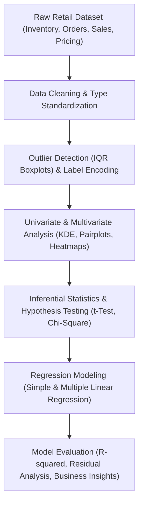

# 📊 Data-Driven Insights into Retail Inventory and Sales Performance Using Statistical Analysis

An end-to-end statistical data science and predictive modeling study evaluating retail inventory optimization, sales velocity, discount impact, and demand forecasting using Python, Scipy, Statsmodels, and Scikit-learn.

---

## 📌 Project Overview

Effective retail management requires balancing inventory holding costs against stockout risks while understanding what drives sales volume. This project conducts a rigorous statistical and econometric investigation on retail sales and inventory data to uncover actionable inventory optimization strategies.

### Core Objectives:
1. **Data Preprocessing & Cleaning:** Handle missing records, eliminate duplicates, cast types, and encode categorical product segments using label encoding.
2. **Exploratory Data Analysis (EDA):** Perform univariate, bivariate, and multivariate analysis (KDE distribution fits, boxplot outlier detection, pairplots, correlation heatmaps).
3. **Statistical Hypothesis Testing:** Conduct inferential tests ($t$-tests, Chi-square tests of independence) to evaluate whether promotional discounts create statistically significant differences in sales volume.
4. **Econometric & Regression Modeling:** Formulate and compare Simple Linear Regression and Multiple Linear Regression models to evaluate demand forecasting drivers.

---

## 🔬 Analytical & Statistical Workflow



---

## 📈 Key Statistical Findings & Insights

- **Discount vs. Sales Volume:** Statistical hypothesis testing ($t$-test) confirmed that discounting yields a statistically significant increase in `Units Sold`, indicating high promotional price elasticity across primary retail categories.
- **Inventory Balance:** Identified category-specific divergence between `Demand Forecast` and `Inventory Level`, highlighting overstock risks in low-velocity categories and stockout vulnerabilities during peak promotional windows.
- **Predictive Drivers:** Multiple Linear Regression incorporating pricing, discount depth, and competitor pricing significantly improves variance explanation ($R^2$) over single-variable baselines.

---

## 📂 Repository Structure

```text
Data-Driven-Insights-into-Retail-Inventory-and-Sales-Performance-Using-Statistical-Analysis/
├── Retail_store_inventory(SDS) (1).ipynb   # Comprehensive 81-cell statistical analysis notebook
└── README.md                               # Project documentation and statistical summary
```

---

## ⚙️ Installation & Execution

### Prerequisites
- Python 3.8+
- Jupyter Notebook or JupyterLab

### Running the Notebook:

1. **Clone the repository:**
   ```bash
   git clone https://github.com/prakruthidevanga/Data-Driven-Insights-into-Retail-Inventory-and-Sales-Performance-Using-Statistical-Analysis.git
   cd Data-Driven-Insights-into-Retail-Inventory-and-Sales-Performance-Using-Statistical-Analysis
   ```

2. **Install required analytical libraries:**
   ```bash
   pip install pandas numpy scipy statsmodels scikit-learn matplotlib seaborn jupyter
   ```

3. **Launch the analysis:**
   ```bash
   jupyter notebook "Retail_store_inventory(SDS) (1).ipynb"
   ```

---

## 🛠️ Technology Stack

- **Language:** Python
- **Statistical Analysis:** Scipy (`scipy.stats`), Statsmodels
- **Data Wrangling:** Pandas, NumPy
- **Visualizations:** Matplotlib, Seaborn
- **Machine Learning / Regression:** Scikit-learn (`LinearRegression`, `LabelEncoder`, metrics)
- **Environment:** Jupyter Notebook

---

## 👩‍💻 Author & Contributions

- **Author:** Prakruthi B R ([@prakruthidevanga](https://github.com/prakruthidevanga))
- **Program:** BCA (Specialization in Artificial Intelligence and Machine Learning), Alliance University.
- **Role:** Individual researcher & analyst — performed exploratory data analysis, formulated hypothesis tests, fitted regression models, and synthesized retail recommendations.
