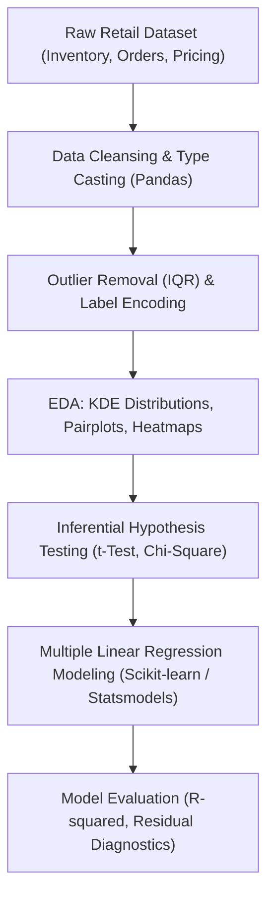

# 📈 Retail Inventory & Sales Performance — Statistical Analysis

<p align="center">
  
</p>

<p align="center">
  An end-to-end econometric and statistical data science study investigating inventory turnover, promotional price elasticity, and demand forecasting drivers using hypothesis testing ($t$-test, Chi-square), regression modeling ($R^2$), and Python analytics libraries.
</p>

<p align="center">
  <a href="https://github.com/prakruthidevanga/Data-Driven-Insights-into-Retail-Inventory-and-Sales-Performance-Using-Statistical-Analysis">
    
  </a>
</p>

<p align="center">
  
  
  
  
</p>

---

## 📌 Table of Contents

- [📖 Project Overview](#-project-overview)
- [🎯 Objectives](#-objectives)
- [✨ Key Statistical Insights](#-key-statistical-insights)
- [🔬 Analytical & Statistical Workflow](#-analytical--statistical-workflow)
- [🛠️ Technology Stack](#️-technology-stack)
- [📁 Repository Structure](#-repository-structure)
- [⚙️ Installation and Setup](#️-installation-and-setup)
- [🔮 Future Enhancements](#-future-enhancements)
- [🤝 Contributing](#-contributing)
- [👩‍💻 Author & Accreditations](#-author--accreditations)

---

## 📖 Project Overview

Retail store management requires finding the optimal equilibrium between holding costs, buffer inventories, stockout penalties, and promotional price elasticity. Decisions based on intuition often result in excessive inventory write-downs or lost revenue during peak demand periods.

This project delivers a rigorous 81-cell statistical and econometric study using Python. By analyzing historical inventory levels, promotional discount depths, competitor pricing, and actual sales volume, the investigation applies **inferential hypothesis testing** and **multivariate regression** to uncover statistically validated patterns in retail sales velocity.

📈 **Core Mission:** Leverage inferential statistics to eliminate guesswork in retail demand forecasting and inventory replenishment.

---

## 🎯 Objectives

- 🧹 **Comprehensive Preprocessing:** Eliminate duplicate transactions, handle missing values, and standardize variable datatypes across sales and inventory records.
- 📊 **Multivariate Exploratory Analysis:** Model numerical variables using Kernel Density Estimation (KDE) distributions, identify outliers via Interquartile Range (IQR) boxplots, and compute correlation matrices.
- 🔬 **Hypothesis Testing:** Conduct two-sample $t$-tests to evaluate whether promotional discount levels produce statistically significant increases in units sold.
- 📉 **Regression Modeling:** Train and compare Simple Linear Regression and Multiple Linear Regression models to evaluate demand forecasting drivers ($R^2$).

---

## ✨ Key Statistical Insights

- **Promotional Elasticity:** Inferential $t$-testing confirms that discounting yields a statistically significant increase in `Units Sold` ($p < 0.05$), validating aggressive promotional strategies for price-elastic retail segments.
- **Inventory Mismatch:** Uncovered significant divergence between `Demand Forecast` and `Inventory Level` in slower-moving product tiers, identifying actionable overstock risks.
- **Multivariate Drivers:** Incorporating competitor pricing and category indices into Multiple Linear Regression models significantly improved variance explanation ($R^2$) compared to univariate baselines.

---

## 🔬 Analytical & Statistical Workflow



---

## 🛠️ Technology Stack

<p align="center">
  
</p>

| Component | Library / Framework | Implementation Details |
| :--- | :--- | :--- |
| **Statistical Computing** | SciPy (`scipy.stats`), Statsmodels | Hypothesis testing ($t$-tests, Chi-square), regression summaries |
| **Machine Learning** | Scikit-learn | Linear regression, preprocessing (`LabelEncoder`, metrics) |
| **Data Manipulation** | Pandas, NumPy | Data cleaning, filtering, and aggregation |
| **Visualizations** | Matplotlib, Seaborn | KDE density plots, correlation heatmaps, regression lines |

---

## 📁 Repository Structure

```text
Data-Driven-Insights-into-Retail.../
├── Retail_store_inventory(SDS) (1).ipynb   # Comprehensive 81-cell statistical analysis notebook
└── README.md                               # Project documentation
```

---

## ⚙️ Installation and Setup

### Prerequisites
- Python 3.8+
- Jupyter Notebook or JupyterLab

### Running the Analysis:
```bash
git clone https://github.com/prakruthidevanga/Data-Driven-Insights-into-Retail-Inventory-and-Sales-Performance-Using-Statistical-Analysis.git
cd Data-Driven-Insights-into-Retail-Inventory-and-Sales-Performance-Using-Statistical-Analysis
python -m venv .venv
.\.venv\Scripts\Activate.ps1
pip install pandas numpy scipy statsmodels scikit-learn matplotlib seaborn jupyter
jupyter notebook "Retail_store_inventory(SDS) (1).ipynb"
```

---

## 🔮 Future Enhancements

- ⏱️ **Time-Series ARIMA / Prophet:** Add seasonal autoregressive forecasting models for multi-quarter predictions.
- 📦 **Automated Reorder Point Engine:** Build a dynamic formula calculator factoring in lead-time variance.

---

## 🤝 Contributing

Contributions and analytical extensions are welcomed!

---

## 👩‍💻 Author & Accreditations

**Prakruthi B R**  
*BCA Student specializing in Artificial Intelligence & Machine Learning*  
*Alliance University, Bengaluru (CGPA: 9.60)*  
*GeeksforGeeks Campus Mantri (2026)*

- 💻 **GitHub:** [@prakruthidevanga](https://github.com/prakruthidevanga)
- 🔗 **LinkedIn:** [Prakruthi BR](https://linkedin.com/in/prakruthi-br)
- 🌐 **Portfolio:** [prakruthidevanga.github.io](https://prakruthidevanga.github.io/)
- 📬 **Email:** [prakruthibr2006@gmail.com](mailto:prakruthibr2006@gmail.com)

---

<p align="center">
  <b>📈 Validating business intuition through statistical rigor and econometric models.</b>
</p>

<p align="center">
  
</p>
